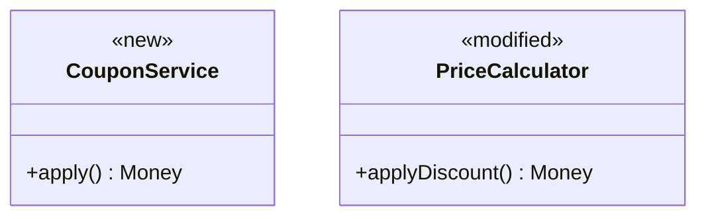
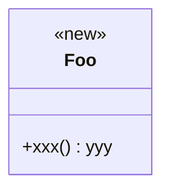

# Rule 1 - 範例是填寫完成的骨架

- Level: `MUST`
- 範例是把骨架填寫完成的版本
- 固定部分原樣保留，結構與骨架一致
- 骨架每個填位符號所在的位置，範例都要有對應的填寫

## Good Example

- 骨架

```text
classDiagram
    class {{類別名稱}} {
        <<{{new 或 modified}}>>
        +{{方法名稱}}() {{回傳型別}}
    }
```

- 範例：固定部分原樣保留，三個填位符號位置都有填寫


## Bad Example

- 骨架同上；範例少了 `<<...>>` 那一行，結構與骨架不一致，對應的填位符號也沒有填寫


# Rule 2 - 範例中不可殘留填位符號

- Level: `MUST`
- 範例中不可殘留任何填位符號
- 骨架中的每個填位符號，在範例中都必須換成實際內容

## Good Example

- 所有填位符號都已換成實際內容


## Bad Example

- 類別名稱與回傳型別仍是填位符號，AI 讀範例時無法判斷該填成什麼樣子

```mermaid
classDiagram
    class {{類別名稱}} {
        <<new>>
        +apply() {{回傳型別}}
    }
```

# Rule 3 - 重複區塊在範例中至少示範兩個實例

- Level: `MUST`
- 骨架中重複出現的區塊只放一個實例，範例必須用至少兩個實例來示範重複的寫法
- 範例中的每個實例都必須是完整填寫的區塊

## Good Example

- 骨架的類別區塊只有一個實例；範例示範兩個類別



## Bad Example

- 範例只有一個類別，看不出多個類別時要怎麼重複區塊


# Rule 4 - 範例內容貼近真實用途

- Level: `SHOULD`
- 填入的內容要像真實產出，貼近該樣板實際的用途
- 不使用 `foo`、`xxx`、`範例1` 這類敷衍的內容

## Good Example

- 類別與方法名稱都是真實情境會出現的名稱


## Bad Example

- 內容全是敷衍的名稱，看不出實際產出該長什麼樣子



# Rule 5 - 範例整個檔案是合法的該格式檔案

- Level: `MUST`
- 範例整個檔案內容必須是合法的該格式檔案，例如 `.mmd` 範例必須是可解析的 Mermaid
- 不可夾帶說明文字或註解式的解說，說明一旦混進去就不再是真實的產出樣子

## Good Example

- 整個檔案只有可解析的 Mermaid


## Bad Example

- 檔案開頭夾了一行說明文字，這不是合法的 Mermaid，也不是真實產出該有的樣子

```text
以下是 new 類別的範例：
classDiagram
    class CouponService {
        <<new>>
        +apply() Money
    }
```
